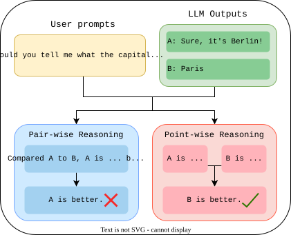

@def title = "Ladislas Walewski"
@def hasmath = true
@def is_homepage = true

{{insert navbar.html}}

~~~
<main class="home-content">
  <section id="home" class="home-about" aria-labelledby="home-title">
    <h1 id="home-title">Ladislas Walewski</h1>
    
I love machine learning and mathematics. Here you’ll find my notes and a few resources related to those topics.

    

      <a href="https://github.com/lads-oxygen" aria-label="GitHub">
        <svg viewBox="0 0 24 24" aria-hidden="true">
          <use href="#github-icon"/>
        </svg>
      </a>
      <a href="https://www.linkedin.com/in/ladislas-walewski/" aria-label="LinkedIn">
        <svg viewBox="0 0 24 24" aria-hidden="true">
          <path fill="currentColor" d="M20.45 20.45h-3.56v-5.57c0-1.33-.03-3.04-1.85-3.04-1.85 0-2.13 1.45-2.13 2.94v5.67H9.35V9h3.42v1.57h.05a3.75 3.75 0 0 1 3.37-1.85c3.61 0 4.27 2.37 4.27 5.46zM5.34 7.43a2.06 2.06 0 1 1 0-4.12 2.06 2.06 0 0 1 0 4.12zm1.78 13.02H3.56V9h3.56zM22.23 0H1.77C.79 0 0 .77 0 1.73v20.54C0 23.23.79 24 1.77 24h20.46c.98 0 1.77-.77 1.77-1.73V1.73C24 .77 23.21 0 22.23 0z"/>
        </svg>
      </a>
    

  </section>

  <section id="posts" aria-labelledby="posts-title">
    <h2 id="posts-title">Blog</h2>
    <ul class="post-previews">
      <li><a class="post-preview" href="/blog/flow-matching/">
        
          
        
        

          <time datetime="2026-11-16">November 16, 2026</time>
          <h3>Flow Matching: From Straight Paths to One-Step Sampling</h3>
          
Experimenting with flow matching and methods for one cheaper generation.

        

      </a></li>
      <li><a class="post-preview" href="/blog/LLM_Evaluation/">
        
          
        
        

          <time datetime="2024-09-02">September 2, 2024</time>
          <h3>A Comparison of Large Language Model (LLM) Evaluation Services</h3>
          
How evaluation methods differ and what the available services offer.

        

      </a></li>
    </ul>
  </section>

  <section id="resources" aria-labelledby="resources-title">
    <h2 id="resources-title">Resources</h2>
    <svg class="resource-icon-defs" width="0" height="0" aria-hidden="true">
      <symbol id="github-icon" viewBox="0 0 24 24">
        <path fill="currentColor" d="M12 0C5.37 0 0 5.37 0 12c0 5.3 3.44 9.8 8.21 11.39.6.11.82-.26.82-.58l-.02-2.23c-3.34.73-4.04-1.42-4.04-1.42-.55-1.39-1.33-1.76-1.33-1.76-1.09-.74.08-.73.08-.73 1.21.08 1.84 1.24 1.84 1.24 1.07 1.84 2.81 1.31 3.5 1 .11-.78.42-1.31.76-1.61-2.66-.3-5.47-1.33-5.47-5.93 0-1.31.47-2.38 1.24-3.22-.13-.3-.54-1.52.11-3.17 0 0 1.01-.32 3.3 1.23a11.5 11.5 0 0 1 6 0c2.29-1.55 3.3-1.23 3.3-1.23.65 1.65.24 2.87.11 3.17.77.84 1.24 1.91 1.24 3.22 0 4.61-2.81 5.63-5.49 5.93.43.37.81 1.1.81 2.22l-.01 3.29c0 .32.22.7.82.58A12 12 0 0 0 24 12C24 5.37 18.63 0 12 0Z"/>
      </symbol>
      <symbol id="pdf-icon" viewBox="0 0 24 24">
        <path d="M5 2h9l5 5v15H5z M14 2v5h5" fill="none" stroke="currentColor" stroke-width="1.3" stroke-linejoin="round"/>
        <text x="12" y="16.5" text-anchor="middle" font-family="Arial, sans-serif" font-size="6" font-weight="700" fill="currentColor">PDF</text>
      </symbol>
    </svg>
    <ul class="home-resources">
      <li>SparseSpikes 
        <a href="https://github.com/Lads-oxygen/SparseSpikes" aria-label="SparseSpikes on GitHub"><svg aria-hidden="true"><use href="#github-icon"/></svg></a>
      </li>
      <li>Complex Analysis notes 
        <a href="/pdf_pages/MA3B8/" aria-label="MA3B8 Complex Analysis notes PDF"><svg aria-hidden="true"><use href="#pdf-icon"/></svg></a>
      </li>
      <li>Lecture notes template 
        <a href="/pdf_pages/Notes/" aria-label="Lecture notes template PDF"><svg aria-hidden="true"><use href="#pdf-icon"/></svg></a>
        <a href="https://github.com/Lads-oxygen/LaTeX-Templates/tree/master/Notes" aria-label="Lecture notes template LaTeX source">\(\LaTeX\)</a>
      </li>
      <li>Assignment template 
        <a href="/pdf_pages/Assignment/" aria-label="Assignment template PDF"><svg aria-hidden="true"><use href="#pdf-icon"/></svg></a>
        <a href="https://github.com/Lads-oxygen/LaTeX-Templates/tree/master/Assignment" aria-label="Assignment template LaTeX source">\(\LaTeX\)</a>
      </li>
    </ul>
  </section>
</main>
~~~
